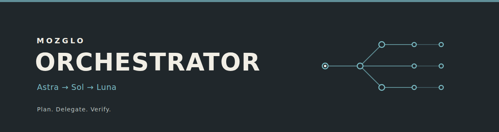

<p align="center"></p>

<p align="center"><a href="LICENSE"></a>  </p>

<p align="center"><strong>Согласованная и восстанавливаемая работа Codex с чёткими ролями.</strong><br>Автор и поддержка: <a href="https://github.com/mozglo">mozglo</a></p>
<p align="center"><a href="README.md">English</a> · <a href="README.zh-CN.md">简体中文</a> · <a href="skills/mozglo-orchestrator/SKILL.md">Skill</a> · <a href="LICENSE">MIT</a></p>

MOZGLO — независимо устанавливаемый skill для Codex. Сначала используйте доступных нативных агентов, если их достаточно; для текущей координации общайтесь через native messages. Запускайте runner один раз, только когда нужны оркестрация или восстановление. Запущенный root не должен запускать другой runner или Codex CLI. Astra ведёт работу и интегрирует результат, Sol координирует и проверяет, Luna выполняет все продуктовые изменения.

## Установка и запуск

Установите skill в Codex через `skill-installer`:

```text
https://github.com/mozglo/mozglo-orchestrator/tree/main/skills/mozglo-orchestrator
```

Затем начните новый сеанс Codex и задайте ограниченную задачу:

```text
$mozglo-orchestrator <task>
```

## Роли и настройка

По умолчанию запрашиваются Astra, один Sol и пять Luna (всего семь агентов); для небольшой задачи хватит Astra и одного Luna. Жёсткий предел — 15 агентов с Astra, фактическая ёмкость может быть ниже. В настройках можно указать ID моделей ролей, reasoning effort, размер команды, sandbox и существующий профиль Codex. Модели по умолчанию — `gpt-6-astra`, `gpt-6.1-sol` и `gpt-6-luna`; это запросы, а не гарантия фактической модели или доступной ёмкости. Переносимый runner требует Linux, Python 3.10+ и существующий аутентифицированный Codex CLI; используются только модули стандартной библиотеки Python.

Ведите единую краткую запись проекта в `.mozglo/context.md`: состав, владельцы задач, решения, подтверждённый прогресс и следующие шаги. Текущие обновления передавайте нативными сообщениями. Итог владельцу содержит одну-три полезные технические иллюстрации и две-четыре короткие строки или ссылки; внутренние передачи задач — только текст.

См. [runtime reference](skills/mozglo-orchestrator/references/runtime.md), [архитектуру](docs/architecture.md) и [правила отчёта](skills/mozglo-orchestrator/references/report.md). Проверка пакета: `python3 scripts/validate.py`.

MOZGLO Orchestrator — независимый проект [mozglo](https://github.com/mozglo). [Лицензия MIT](LICENSE).
